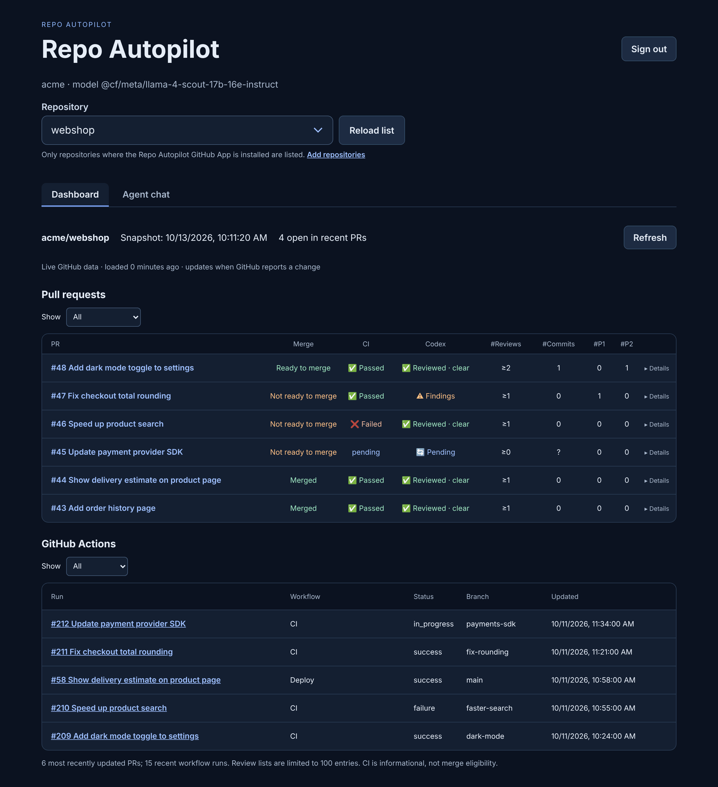
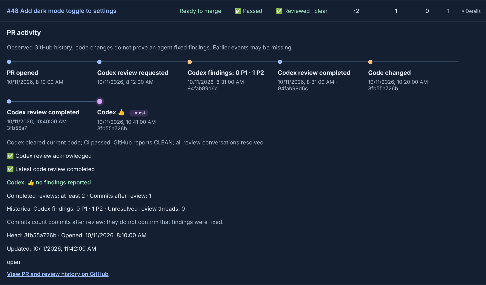
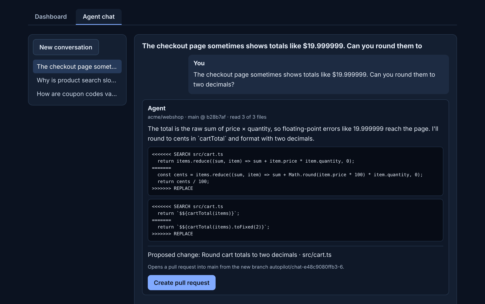
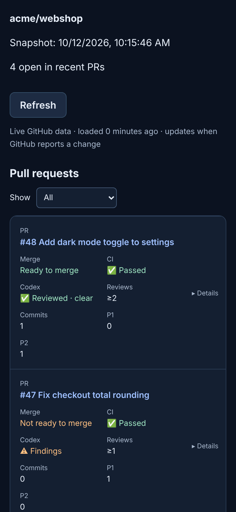

# Repo Autopilot

An open-source GitHub dashboard and coding-agent chat for your repositories. MIT licensed.

Repo Autopilot is one app on Cloudflare Workers with GitHub sign-in: a live dashboard and the agent chat in two tabs, for any repository where its GitHub App is installed. See [Repo Autopilot app on Cloudflare Workers](#repo-autopilot-app-on-cloudflare-workers).

Automatic merge is **off**. The coding agent proposes changes as pull requests; it does not execute generated code or merge changes. A successful CI indicator is informational: it does not establish branch protection, resolved conversations, current review approval, or merge eligibility.

## Screenshots

<p align="center"></p>

**Dashboard.** Pick a repository, then see at a glance which pull requests are ready to merge, which have failing CI or open Codex findings, and what GitHub Actions is running. It updates within seconds when GitHub reports a change.

<p align="center"></p>

**PR activity.** Expand a pull request to follow its history as a chain: review requests, Codex findings, new commits, completed reviews and the final 👍.

<p align="center"></p>

**Agent chat.** Ask about the code or describe a change, with an optional screenshot. The agent reads the repository's current files, answers with exact edits, and opens a pull request when you press **Create pull request**.

<p align="center"></p>

**Phone and tablet.** The layout adapts to small screens, and the controls are sized for touch.

<sub>The screenshots use invented demo data.</sub>

## Development

Requires Node.js 22 or later. There are no dependencies.

```sh
npm run check
npm test
```

## Product roadmap

1. Dashboard foundation.
2. GitHub App authentication and repository selection (done); full pagination and precise Codex review/reaction tracking.
3. MCP tools and a ChatGPT-compatible dashboard component, tested against current OpenAI documentation and supported clients. This repository is not yet an installable ChatGPT plugin.
4. Optional external orchestration: review feedback → code-agent fix → CI → re-review. Explicit per-repository opt-in, bounded retries, audit history and human stop controls.
5. Optional merge policy enforcing current-head review approval, required checks, branch rules and resolved feedback.

ChatGPT UI integration and background work are separate components: a dashboard presents state; an external worker continues tasks when the chat is closed. Future code-agent use may require paid API access or other compute; no subscription coverage or free hosting is assumed.


## PR progress and merge readiness

PR cards show review acknowledgement, completion for the latest code, Codex outcome, completed review rounds, commits after review and merge readiness. Confirmation summaries and raw technical feedback are hidden; use the GitHub history link for details.

Review counts are **lower bounds**: GitHub edits Codex summaries in place, so some older clean rounds cannot be recovered. Review submissions, outcome comments and summaries for the same commit within 10 seconds are deduplicated. Commits after review counts subsequent commits in the PR after the earliest reviewed commit found in its history; it does not prove that feedback was fixed. Missing/truncated histories show unknown update counts.

Readiness distinguishes merged, closed, known blockers and unverified state. It does **not** show green merge readiness from CI alone: the dashboard also asks GitHub GraphQL for current-head merge state, review decision and conversation resolution. Ready requires current Codex clearance, complete successful CI, conflict-free merging, GitHub CLEAN state, no missing approvals or requested changes, and all conversations resolved. Truncated thread results or API errors stay unverified. This is a snapshot, never permission to bypass GitHub rules or an automatic merge action. If the GraphQL read fails, readiness stays unknown.

## Activity flow and filters

PR rows expand to a chronological activity flow: PR opened, explicit Codex review requests, observed running/completed reviews, subsequent commits, current-commit Codex thumbs-up and merge. This is observed history, not proof that an agent fixed a finding. Commit timestamps may precede their push, summaries are edited in place, and older/truncated events may be missing. No missing steps are invented.

Filter PRs by open, needs attention, merged or all, and workflows by CI, deployment or all. On wide screens, shared column headings reduce repetition.

Historical P1/P2 counts use top-level Codex finding comments with explicit priority badges, deduplicated by comment identity. Replies and summary text do not count as new findings. Counts remain after resolution; incomplete history is marked as a lower bound. The separate unresolved-thread count includes all reviewers and is unverified if authenticated thread retrieval fails. #Commits counts commits after review, not the number of findings fixed.

## Repo Autopilot app on Cloudflare Workers

`worker/` is a Cloudflare Worker with two tabs, **Dashboard** and **Agent chat**, behind GitHub sign-in.

### Choosing a repository

The **Repository** menu at the top lists the repositories where the Repo Autopilot GitHub App is installed, most recently pushed first; a GitHub App sign-in can only reach those. To stay within the Workers subrequest limit, the list covers up to 5 installations and 200 repositories each. It is a large native menu, so on Android tablets it opens the system's full-screen touch list. The choice is remembered on the device and applies to both tabs. Conversations belong to the repository they started in: the chat list shows the selected repository's conversations, and opening an older conversation switches the menu to its repository.

To add a repository, open **Add repositories** (GitHub → Settings → Applications → Repo Autopilot → Configure), select it, then tap **Reload list**.

### Dashboard

The **Dashboard** tab reads live data from GitHub with your sign-in: the 6 most recently updated pull requests with merge readiness, CI, Codex progress and activity flow, and 15 recent GitHub Actions runs. The overview takes three GitHub requests and each pull request is loaded by its own request with at most ten, so every Worker call stays well under the Workers subrequest limit. Results are cached in the Durable Object for a minute (an hour for merged or closed pull requests); a pull request whose `updatedAt` changed, and the **Refresh** button, bypass the cache. With the [webhook](#live-updates-with-the-webhook) set up, the tab reloads within about 15 seconds of a change on GitHub; without it, every three minutes while it is open. When a chat answer has become a pull request, **Follow in dashboard** opens that pull request's row. Addresses keep the view: `#dashboard`, `#pr-<number>`, `#chat` and `#chat/<conversation>`.

### Agent chat

The **Agent chat** tab lets you talk to the coding agent directly. You sign in with GitHub, ask about the code or describe a change, and can attach or paste a screenshot. For each message the Worker downloads the current default branch as one archive. It sends whole relevant files, not excerpts, to the model together with the conversation. Answers arrive within seconds once the model replies.

When the agent proposes a change it adds exact search/replace blocks. The Worker checks them against the current files, and each search text must match exactly once. Which files may be edited depends on the repository:

- **Other repositories:** source, style, page and documentation files (for example `.js`, `.ts`, `.tsx`, `.css`, `.html`, `.md`, `.py`, `.go`, `.rs`, `.java`, `.cs`, `.rb`, `.php`). Never files in hidden folders such as `.github`, package manifests (`package.json`, `requirements*.txt`, `setup.py`), lockfiles, environment files, `node_modules`, build output, or build and test-runner configuration (`*.config.*`, `conftest.py`, `build.rs`, `Package.swift`, `mix.exs`, `project.clj`, webpack, gulp and Grunt files).
- **Repo Autopilot itself:** only README and `.js`, `.css`, `.html` and `.md` files under `src/`, `public/` and `test/`, minus the files the Worker runs on (see *Limits*).

 
If a block does not apply, the model gets one correction round. A **Create pull request** button then re-applies the edits to the latest default branch and opens a pull request with your GitHub account, so CI runs on it as usual. The agent never merges on its own; you can merge from the chat when you decide to.

The chat shows what the agent works on and what it is doing:

- **While it answers**, each step appears as it happens: reading the latest code (branch and commit), choosing the relevant files, asking the model, checking the proposed edits and any correction round.
- **Each answer** names the repository, branch and commit it is based on and how many files the agent read, for example `acme/webshop · main @ 3fb55a7 · read 14 of 312 files`. When the branch has newer commits, the line says so.
- **A proposed change** names the branch the pull request will target and the new branch it is opened from (`autopilot/chat-…`). Once opened, it shows the pull request's number, CI, Codex status and merge readiness, kept current by the webhook. A **Merge** button squash-merges it from the chat after you confirm: it is disabled while GitHub reports a blocker (failed CI, conflicts, requested changes, Codex findings), the server checks those blockers again just before merging, and it merges only the exact commit whose status you saw, and removes the chat's branch afterwards. GitHub's branch protection, required checks and reviews still apply.
- **Pull request descriptions** are written automatically: your request, the agent's explanation and the files it changes.

- **Model:** Workers AI with `@cf/meta/llama-4-scout-17b-16e-instruct` by default. This model reads images, and the binding needs no API key. Each message sends up to `CONTEXT_CHARS` characters of files (default 60,000, roughly 15–20k tokens). The free Workers AI allocation is a fixed daily amount, so it covers a limited number of messages per day; check usage in the Cloudflare dashboard under AI → Workers AI. Set the repository variable `AUTOPILOT_CHAT_MODEL` to use another Workers AI model. To use an OpenAI-compatible provider instead, set the repository variables `AUTOPILOT_CHAT_MODEL_PROVIDER=openai-compatible`, `AUTOPILOT_CHAT_MODEL_BASE_URL` (HTTPS, for example `https://api.groq.com/openai/v1`) and `AUTOPILOT_CHAT_MODEL`, plus the secret `AUTOPILOT_CHAT_MODEL_API_KEY`. `AUTOPILOT_CHAT_CONTEXT_CHARS` changes the file budget. Make these changes in the repository settings, not the Cloudflare dashboard: each deploy replaces the Worker's variables.
- **Storage and security:** Conversations, sessions and locks live in one SQLite-backed Durable Object in your Cloudflare account. They are private. Sign-in uses the GitHub App user flow with PKCE and an encrypted, browser-bound state. Only the configured owner is admitted, and only GitHub App user tokens (`ghu_`) are accepted. The token is valid for at most eight hours and is stored server-side; the browser only gets an HttpOnly session cookie, and only a hash of that cookie is stored. Writes require the exact origin and a CSRF token, and one answer is generated at a time. The Worker holds no long-lived GitHub write credential.
- **Images:** The browser scales images down and converts them to JPEG before upload. The image is sent to the model for that message only and is not stored.
- **Limits:** The agent cannot edit the code it runs on (`worker/` and the files it bundles: `src/agent.js`, `src/github.js`, `src/codex.js`, `src/progress.js`), workflows, dependencies or credentials. A test fails if the Worker starts bundling another repository file without making it read-only. Edits keep each file's line endings. On the Workers Free plan each request has a small CPU budget; the archive is decompressed natively to stay within it. If Cloudflare reports *Worker exceeded CPU time limit*, lower `AUTOPILOT_CHAT_CONTEXT_CHARS` or switch to Workers Paid. Very large repositories may still exceed the free CPU budget or the archive size limit (12 MB); the chat then reports an error, and the dashboard keeps working.

### Set up the app

1. **GitHub App.** Create a GitHub App owned by your account, install it on the repositories you want to work with, and give it **Contents** and **Pull requests** set to *Read and write* and **Actions**, **Checks**, **Commit statuses** and **Issues** set to *Read-only* (the dashboard reads workflow runs, checks, statuses and PR comments with your sign-in, which only has the app's permissions). In the app settings:
   - Add the callback URL `https://repo-autopilot-chat.<your-subdomain>.workers.dev/auth/callback`.
   - Keep **Expire user authorization tokens** enabled.
   - Generate a client secret.
2. **Cloudflare API token.** In the Cloudflare dashboard, create an API token from the **Edit Cloudflare Workers** template and copy your **Account ID**.
3. **Repository settings.** Under *Settings → Secrets and variables → Actions*, add:
   - the secrets `CLOUDFLARE_API_TOKEN`, `CLOUDFLARE_ACCOUNT_ID` and `AUTOPILOT_CHAT_CLIENT_SECRET` (the app's client secret)
   - the variable `AUTOPILOT_CHAT_CLIENT_ID` (the app's client ID)
4. **Deploy.** Run the **Agent chat Worker** workflow, or push a change under `worker/`. It runs the tests, then deploys with Wrangler and uploads the client secret together with the code, so no version runs without it. Without the settings it only builds and skips deployment.
5. **Owner account.** Only the repository owner can sign in. For a repository owned by an organization, set the repository variable `AUTOPILOT_TASK_USER` to the GitHub login allowed to use the app, then run the **Agent chat Worker** workflow again: the value is applied when the Worker is deployed.
6. **Webhook (recommended).** See below.

### Live updates with the webhook

GitHub can tell the app when something changes, so the dashboard updates within seconds instead of every three minutes. The webhook only clears the cached data the event affects; the dashboard then reloads it with your sign-in, so the Worker still needs no long-lived GitHub credential.

1. Create a random secret, for example with `openssl rand -hex 32`.
2. Add it as the repository secret `AUTOPILOT_WEBHOOK_SECRET`, then run the **Agent chat Worker** workflow so the Worker gets it.
3. In the GitHub App settings (*General → Webhook*), check **Active**, set the **Webhook URL** to `https://repo-autopilot-chat.<your-subdomain>.workers.dev/api/webhook` and the **Webhook secret** to the same value.
4. Under *Permissions & events → Subscribe to events*, check **Pull request**, **Pull request review**, **Pull request review comment**, **Pull request review thread**, **Issue comment**, **Check run**, **Check suite**, **Status**, **Workflow run** and **Push**.

Every delivery is verified with GitHub's `X-Hub-Signature-256` HMAC; without the secret the endpoint is disabled. Check and status events are matched with the head commits of loaded pull requests, so checks on other branches cause no reload, and data loaded while an event arrived is not cached. Each deploy keeps Worker secrets that are not in the workflow; to turn the webhook off, uncheck **Active** in the app settings. *Recent Deliveries* in the app settings shows each delivery; a working setup answers `204`. Events from every repository where the app is installed are handled. Reactions (such as the Codex thumbs-up) send no event and appear on the next load.

Local check: `npx wrangler deploy --dry-run --config worker/wrangler.jsonc` bundles the Worker without deploying.

